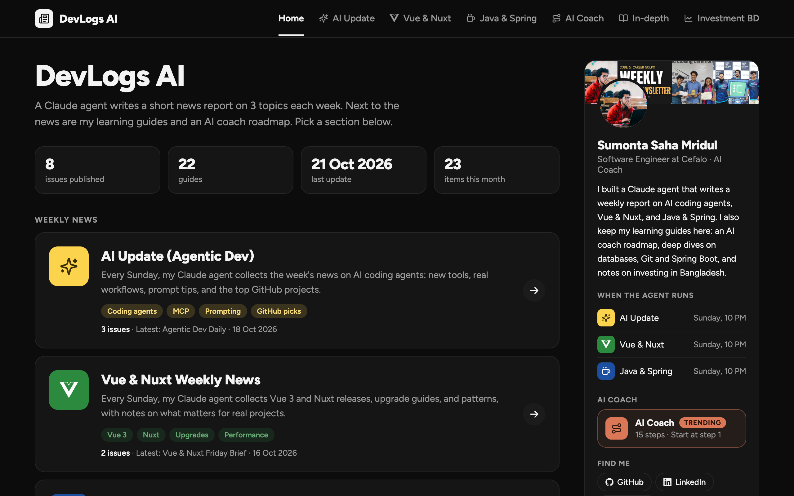
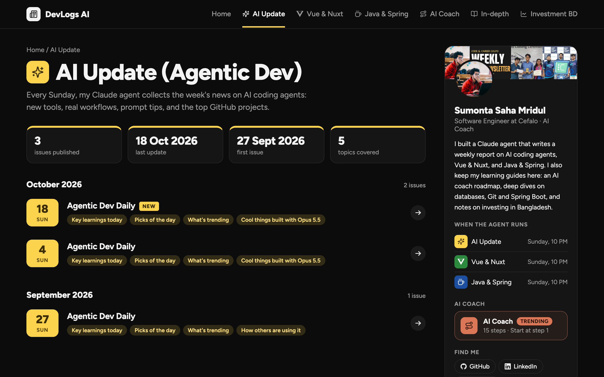
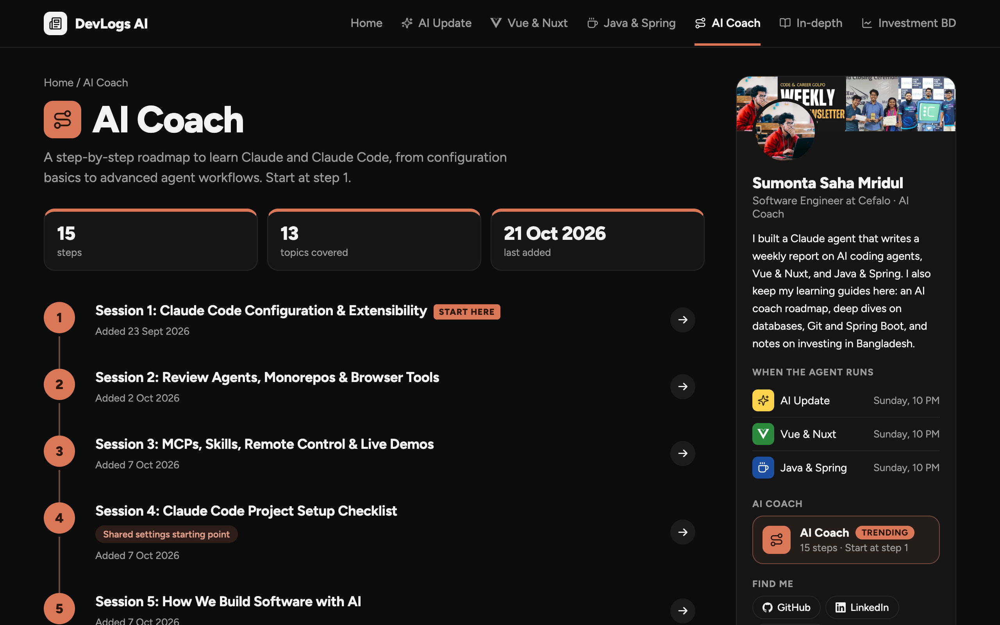

<h1 align="center">DevLogs AI</h1>

<p align="center">
  <b>One site for weekly AI news and learning guides.</b><br>
  A Claude agent writes a short news report on 3 topics each week. Next to the news are learning guides and an AI Coach roadmap, all as plain HTML pages.
</p>

<p align="center">
  <a href="https://github.com/Sumonta056/devLogs-ai/actions/workflows/deploy.yml"></a>
  
  
  
</p>

<p align="center">
  <a href="https://sumonta056.github.io/devLogs-ai/"><b>Website</b></a> ·
  <a href="#quick-start"><b>Quick start</b></a> ·
  <a href="#sections"><b>Sections</b></a> ·
  <a href="https://github.com/Sumonta056/devLogs-ai"><b>GitHub</b></a>
</p>

```bash
npm run build && python3 -m http.server 4173
```

<p align="center">
  
</p>

---

## Contents

- [Why DevLogs AI](#why-devlogs-ai)
- [Features](#features)
- [Sections](#sections)
- [Quick start](#quick-start)
- [Commands](#commands)
- [Add a page](#add-a-page)
- [Naming rules](#naming-rules)
- [How dates work](#how-dates-work)
- [Deploy](#deploy)
- [Privacy](#privacy)
- [How it works](#how-it-works)
- [Limitations](#limitations)
- [Tests](#tests)

## Why DevLogs AI

News, notes, and guides pile up as loose files. A folder of HTML pages is hard to browse, and a framework is too much for static pages.

- **One home page.** Every public section on one page, with a floating nav on each report.
- **No manual index.** Add a file, run one command, and the index pages update.
- **No dependencies.** Plain Node 20 scripts and plain HTML. There is nothing to install.
- **One config file.** `scripts/site-config.mjs` holds the sections, colors, and titles.

## Features

### Home page and section pages

- A profile header and one card for each public section.
- Each section has its own index page with its own color.
- The index pages are generated. Never edit them by hand.


### Weekly news

- Three news sections: AI Update, Vue & Nuxt, and Java & Spring.
- A Claude agent writes one report for each section every Sunday at 10 PM.
- Reports sort newest first.



### AI Coach roadmap

- A step-by-step path to learn Claude and Claude Code, in a fixed order.
- 15 sessions, from configuration basics to advanced agent workflows.
- The order comes from the `order` list in `scripts/site-config.mjs`.



### Learning guides

- Long guides on one topic: databases, SQL tuning, Git, and Spring Boot.
- Beginner guides on how to invest in Bangladesh.
- Guides sort newest first, then by title.

### Floating nav widget

- A small widget on every public page that lists all sections and pages.
- The build adds the widget script to each content page and updates its CSP meta tag.
- The widget reads `assets/nav-data.json`.

## Sections

| Folder                    | Kind      | What it holds                                           |
| ------------------------- | --------- | ------------------------------------------------------- |
| `ai-update-weekly/`       | `news`    | Weekly news on AI coding agents                         |
| `vue-nuxt-weekly-news/`   | `news`    | Weekly Vue 3 and Nuxt news                              |
| `java-spring-weekly-news/`| `news`    | Weekly JDK and Spring Boot news                         |
| `ai-coach/`               | `roadmap` | Claude and Claude Code roadmap, in a fixed order        |
| `in-depth-learning/`      | `guides`  | Long guides on databases, SQL, Git, and Spring Boot     |
| `investment-bd/`          | `guides`  | Beginner investing guides for Bangladesh                |
| `personal-guide/`         | `guides`  | Private notes. Not in the public repo or the deploy     |

## Quick start

You need Node 20 or newer and Python 3 for the preview server.

```bash
git clone https://github.com/Sumonta056/devLogs-ai.git
cd devLogs-ai
npm run build
python3 -m http.server 4173
```

Open `http://127.0.0.1:4173/`. Press `Ctrl+C` to stop the server.

## Commands

| Command                                   | Meaning                                              |
| ----------------------------------------- | ---------------------------------------------------- |
| `npm run build`                           | Rebuild all index pages and the nav data             |
| `npm test`                                | Run the tests in `scripts/lib.test.mjs`              |
| `BASE_PATH=/sub npm run build`            | Build for a deploy under a sub-path                  |
| `python3 -m http.server 4173`             | Preview the site at `http://127.0.0.1:4173/`         |
| `./scripts/publish.sh`                    | Rebuild, commit, pull, and push                      |

## Add a page

1. Put the HTML file in the section folder.
2. Name it with the [naming rules](#naming-rules).
3. Run `npm run build`.
4. Open the section index and check that the page is listed.

For a roadmap section, also add the file name to `order` in `scripts/site-config.mjs`. A file that is not in `order` shows a warning and goes last.

## Naming rules

File names use lowercase kebab-case. The pattern follows the kind of section.

| Kind      | Pattern                  | Example                                |
| --------- | ------------------------ | -------------------------------------- |
| `roadmap` | `NN-topic.html`          | `01-claude-code-configuration.html`    |
| `news`    | `series-YYYY-MM-DD.html` | `ai-update-2026-10-25.html`            |
| `guides`  | `topic.html`             | `git-deep-dive.html`                   |

Display titles use a colon as the separator, for example `Session 1: Claude Code Configuration & Extensibility`. Use the `/organize-naming` skill in `.claude/skills/organize-naming/` to rename files.

## How dates work

The build finds the date of each page in this order.

1. A `YYYY-MM-DD` in the file name.
2. An entry in `scripts/dates.json`.
3. The file modification time.

The build writes dates that do not come from the name back to `scripts/dates.json`. When you rename a file, move its key in `dates.json` too.

## Deploy

| Part         | Rule                                                                                                          |
| ------------ | ------------------------------------------------------------------------------------------------------------- |
| GitHub Pages | `.github/workflows/deploy.yml` runs on each push to `main`. It builds with `BASE_PATH`.                       |
| Files copied | Only `index.html`, `robots.txt`, `assets/`, and the public section folders.                                   |
| Auto publish | `scripts/publish.sh` rebuilds, commits, pulls, and pushes.                                                    |
| Watcher      | `scripts/com.mridul.reports-publish.plist` is a launchd template. Replace the `YOURNAME` paths before you use it. |

## Privacy

| Topic             | Rule                                                                                  |
| ----------------- | ------------------------------------------------------------------------------------- |
| Private section   | `personal-guide/` is in `.gitignore`. It exists only on the local disk.               |
| Nav and home page | Sections with `visibility: 'private'` are left out of the nav and the home page.      |
| Deploy            | Private sections are not copied to GitHub Pages.                                      |
| Search engines    | `robots.txt` disallows `/personal-guide/`.                                            |

## How it works

DevLogs AI is plain HTML with Node 20 scripts. There is no framework, no bundler, and no npm dependency. Each section folder holds self-contained pages. The build generates the rest.

```
scripts/site-config.mjs   Single source of truth: SITE, PROFILE, and one REPORTS entry per section
scripts/build-index.mjs   Generates index pages and nav data, and patches content pages
scripts/lib.mjs           Pure logic: sorting, titles, dates, CSP patching, nav data
scripts/lib.test.mjs      Tests for lib.mjs
scripts/dates.json        Entry dates that do not come from the file name
scripts/publish.sh        Rebuild, commit, pull, and push
assets/                   site.css, nav-widget.js, nav-data.json, icons, and the cover image
<section>/                Self-contained HTML pages for one section
.github/workflows/        GitHub Pages deploy
.claude/skills/           The organize-naming skill
docs/images/              README screenshots
```

Never edit generated files by hand. These are `index.html`, each `<section>/index.html`, and `assets/nav-data.json`. On a merge conflict in them, fix the source files and run `npm run build`.

## Limitations

1. Index pages are generated. A hand edit is lost at the next build.
2. The build edits content pages. It adds the nav script and a `'self'` CSP source.
3. A file rename needs a matching key change in `dates.json`, `order`, and `titles`.
4. The LinkedIn and YouTube profile links are placeholders.
5. The launchd template still has `YOURNAME` placeholder paths.

## Tests

No test framework: Node's built-in test runner.

```bash
npm test
node --test --test-name-pattern="titleOf" scripts/lib.test.mjs
```
